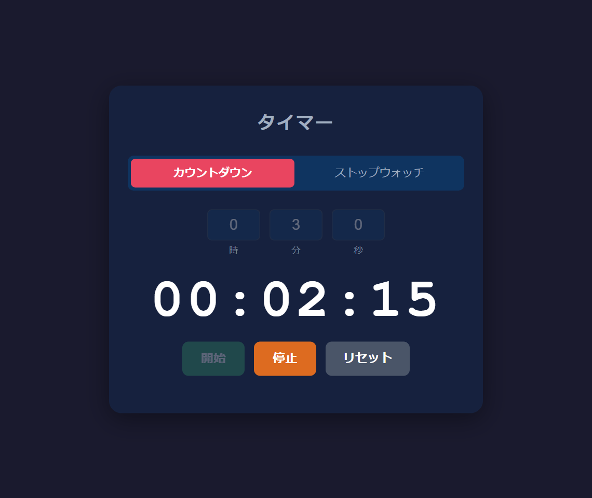
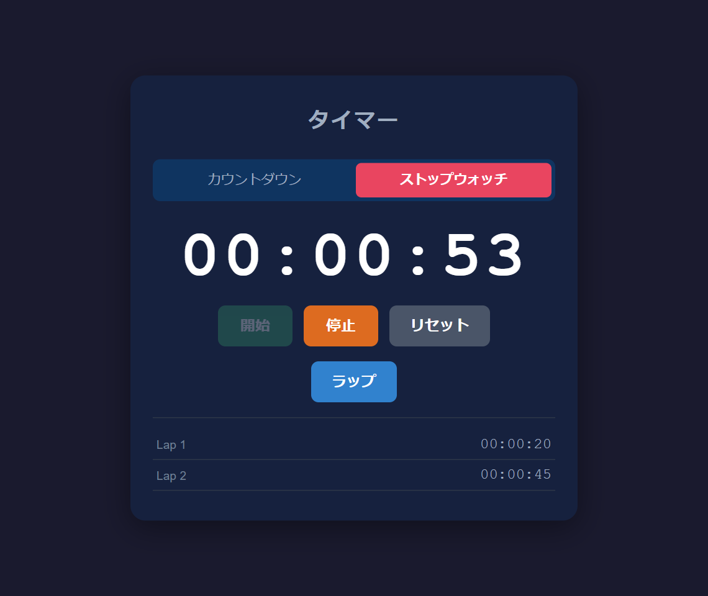

# ポートフォリオ

## 概要
Vanilla JavaScript で実装したカウントダウンタイマー＆ストップウォッチです。  
ZennのWEB書籍を執筆するために制作しました。  
アプリ名：TimerApp  
WEB書籍：[JavaScript入門 - タイマーアプリを作ってみよう!](https://zenn.dev/eguchi244_dev/books/js-timer-tutorial-eguchi244)

 

## 制作経緯
本アプリとWEB書籍は、フレームワークを使う前の JavaScript の基礎を学ぶチュートリアル教材として活用したいという気持ちから制作しました。

制作にあたっては下記の項目を

* フレームワーク・外部ライブラリを使わず、ブラウザだけで動かす
* `setInterval` / `clearInterval` によるタイマーの制御を体験する
* 「状態を変えてから、状態をもとに画面を作る」設計を一貫させる
* `Date.now()` を基点にした計算で、長時間動かしてもずれないタイマーにする
* Web Audio API と `async/await` で、タイムアップ時に音を鳴らす

満たす体験を実現するようにしました。

## 要件&仕様
本アプリは下記の

* カウントダウンとストップウォッチをタブで切り替えられる
* カウントダウンは時・分・秒を入力して開始し、0 になると通知・点滅・ビープ音で知らせる
* 範囲外の値（秒に `90` など）は自動で範囲内に補正する
* ストップウォッチはラップタイムを一覧に記録できる
* 状態（計測中・一時停止・タイムアップ）に応じて、ボタンと入力欄の有効/無効が切り替わる
* スマートフォンの狭い画面でも表示が崩れない

を要件とする簡易なアプリです。

## システム構成
【技術スタック】
* HTML5, CSS3
* JavaScript（ES6+）
* Web Audio API
* 外部ライブラリ・ビルドツール不使用

【ディレクトリ構成】
```
JS-Timer-Tutorial-PJ（ルートディレクトリ）
├── index.html   # マークアップ・タブUI
├── style.css    # スタイル
├── script.js    # タイマーロジック・DOM操作
├── img          # README の画面
└── README.md
```

## WEB書籍の章とブランチ
WEB書籍の各章の末尾にある「ここまでのソースコード」は、下記のブランチを指しています。答え合わせにご活用ください。

| 章 | ブランチ | 内容 |
|---|---|---|
| [入門03 - シンプルなストップウォッチを作る](https://zenn.dev/eguchi244_dev/books/js-timer-tutorial-eguchi244/viewer/js-timer-stopwatch) | `Chapter03/シンプルなストップウォッチを作る` | 入門03を終えた時点のコード |
| [入門04 - カウントダウンとドリフト補正](https://zenn.dev/eguchi244_dev/books/js-timer-tutorial-eguchi244/viewer/js-timer-countdown) | `Chapter04/カウントダウンとドリフト補正` | 入門04を終えた時点のコード |
| [入門05 - 完成版の仕上げ](https://zenn.dev/eguchi244_dev/books/js-timer-tutorial-eguchi244/viewer/js-timer-finish) | `Chapter05/完成版の仕上げ` | 入門05を終えた時点のコード（完成版と同じ） |
| ― | `main` | 完成版 |

## 前提条件
PCに下記がインストールされていること。

* モダンブラウザ（Google Chrome 最新版を基準に動作確認）
* Git（ZIP でダウンロードする場合は不要）
* VS Code + Live Server 拡張機能（任意。保存するたびにブラウザが自動でリロードされる）

## 環境構築
Github から TimerApp をローカル環境に構築する手順です。  
任意の作業フォルダ内で下記を実施してください。

1. GitHubよりプロジェクトをダウンロードする
```
$ git clone https://github.com/eguchi244/JS-Timer-Tutorial-PJ.git
$ cd JS-Timer-Tutorial-PJ
```
2. 章の途中のコードを見たい場合は、ブランチを切り替える（任意）
```
$ git switch Chapter03/シンプルなストップウォッチを作る
```

## 動作確認
1. index.html をブラウザで開く  
VS Code の場合は `index.html` を右クリック →「Open with Live Server」で起動します。ダブルクリックでブラウザに直接開いても動作します。
2. カウントダウンを確認する  
「カウントダウン」タブで時・分・秒を入力して開始ボタンをクリックすると、残り時間が減っていきます。0 になると通知が表示され、ビープ音が鳴ります。
3. ストップウォッチを確認する  
「ストップウォッチ」タブで開始ボタンをクリックすると、経過時間が進みます。ラップボタンをクリックすると、その時点の時間が一覧に追加されます。
